# Datamodel (ERD) – Persoonlijk Dashboard

Versie 2 (8 nov 2026). Wordt bijgewerkt bij elke nieuwe migratie, in dezelfde commit.

```mermaid
erDiagram
    users ||--o{ tasks : heeft
    users ||--o{ reminders : heeft
    users ||--o{ events : heeft
    users ||--o{ categories : heeft
    users ||--o{ category_rules : heeft
    users ||--o{ transactions : heeft
    users ||--o{ recurring_transactions : heeft
    users ||--o{ balances : heeft
    users ||--o{ budgets : heeft
    users ||--o{ savings_goals : heeft
    users ||--o{ learning_goals : heeft
    users ||--o{ projects : heeft
    tasks ||--o{ reminders : "kan hebben"
    categories ||--o{ transactions : groepeert
    categories ||--o{ recurring_transactions : groepeert
    categories ||--o{ budgets : "budget per"
    categories ||--o{ category_rules : "doel van"

    users {
        bigint id PK
        string name
        string email UK
        string password
        text two_factor_secret "encrypted, nullable"
        text two_factor_recovery_codes "encrypted, nullable"
        timestamp two_factor_confirmed_at "nullable, MFA pas actief na bevestigen"
        string github_id UK "nullable"
        json dashboard_layout "nullable, widget-indeling"
        int xp "default 0"
    }
    tasks {
        bigint id PK
        bigint user_id FK
        string title
        text description "nullable"
        string status "enum: todo, bezig, klaar"
        string priority "enum: laag, normaal, hoog"
        datetime due_at "nullable"
        datetime completed_at "nullable"
    }
    reminders {
        bigint id PK
        bigint user_id FK
        bigint task_id FK "nullable, cascadeOnDelete"
        string message
        datetime remind_at
        datetime sent_at "nullable"
    }
    events {
        bigint id PK
        bigint user_id FK
        string title
        text description "nullable"
        string location "nullable"
        datetime starts_at
        datetime ends_at
        boolean all_day
        string source "enum: handmatig, ical"
        string external_uid "nullable, iCal-UID tegen dubbelen"
    }
    categories {
        bigint id PK
        bigint user_id FK
        string name
        string type "enum: inkomen, uitgave"
        string color "nullable, voor grafieken"
    }
    category_rules {
        bigint id PK
        bigint user_id FK
        bigint category_id FK
        string match_text "tekst in omschrijving"
    }
    transactions {
        bigint id PK
        bigint user_id FK
        bigint category_id FK "nullable = nog nakijken"
        text description "encrypted"
        text amount "encrypted, + inkomen / - uitgave"
        date date
        string import_hash "nullable, unique per user"
    }
    recurring_transactions {
        bigint id PK
        bigint user_id FK
        bigint category_id FK "nullable"
        text description "encrypted"
        text amount "encrypted"
        string frequency "enum: wekelijks, maandelijks, jaarlijks"
        date next_due_on
        boolean active
    }
    balances {
        bigint id PK
        bigint user_id FK
        text amount "encrypted"
        date date "saldo op dit moment"
    }
    budgets {
        bigint id PK
        bigint user_id FK
        bigint category_id FK
        text amount "encrypted"
        date month "unique: user_id + category_id + month"
    }
    savings_goals {
        bigint id PK
        bigint user_id FK
        string name
        text target "encrypted"
        text saved "encrypted"
        date deadline "nullable"
    }
    learning_goals {
        bigint id PK
        bigint user_id FK
        string title
        text description "nullable"
        string url "nullable, cursuslink"
        string type "enum: leerdoel, te-leren, hbo"
        string status
        date due_at "nullable"
    }
    projects {
        bigint id PK
        bigint user_id FK
        string name
        string github_repo "nullable"
    }
```

## Afspraken

- **Elke tabel heeft `user_id`** met `cascadeOnDelete`. Queries altijd via `$request->user()->...` of een Policy.
- **Bedragen versleuteld** (`encrypted` cast) in transactions, recurring_transactions, balances, budgets en savings_goals. Gevolg: MySQL kan niet `SUM`men, dus totalen worden in PHP berekend. Voor één gebruiker is dat prima.
- **Indexen** op wat vaak gefilterd wordt: `tasks (user_id, status)`, `tasks (user_id, due_at)`, `reminders (remind_at, sent_at)`, `transactions (user_id, date)`.
- **Eigendom controleren:** een `category_id` of `task_id` uit een request moet van dezelfde user zijn (validatie met `Rule::exists(...)->where('user_id', ...)`).
- **Enums** als PHP-enums (`app/Enums`) met een cast op het model.

## Niet in dit ERD (standaard van Laravel/Sanctum)

`personal_access_tokens`, `sessions`, `cache`, `jobs`, `password_reset_tokens` en eventueel `notifications` (keuze bij stap 8).
Tijdelijk MFA-login-token en eenmalige GitHub-code: **cache** met verlooptijd van 5 minuten, geen tabel.
